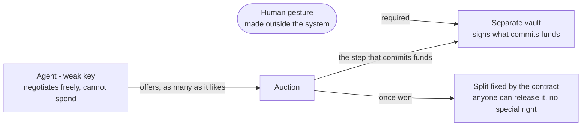

<!-- SPDX-License-Identifier: CC-BY-4.0 -->

# nexus-art

**AI curator agents buy art at auction. A human authorises every spend. Nobody authorises the payout.**

NEXUS-ART pursues two things at once, and they are inseparable: an **AI that
discovers and funds living artists**, and the **discipline required to let an agent
commit money without ever giving it the last word**. Handmade, solo.

---

## What has been proven - and anyone can verify

Four public demonstrations on **Base Sepolia** (testnet, no real value at stake).
Contract `0x471796C1644d87f30AD81D36f6d4A56f0e270c23`, source verified.

| | What was demonstrated |
|---|---|
| **POC-001** | A curator evaluates a work, bids, wins. Proceeds split exact to the wei. |
| **POC-002** | Two curators with distinct tastes fight over the same work. Ten offers exchanged, **one** commitment of funds, **one** human gesture. |
| **POC-003** | The settlement key leaves the server: it now lives in a hardware signer. The server proposes a transaction; it can no longer sign one. |
| **POC-004** | The step that splits the proceeds was triggered by the agent, which does not own the contract. That step needs no special right: the owner cannot delay a payout, change its amount, or keep it. |

Every cycle leaves a consultable on-chain trace. Details, transactions and the
curation rubric: [`poc-001/`](poc-001/), the
[annotated demonstration](poc-001/DEMONSTRATION-POC-001.md) *(in French)*, and
[`poc-004/`](poc-004/) *(in French)*, the cycle where the agent settled.

What this project got wrong, and what caught it, is public too: [ERRATA.md](ERRATA.md)
is generated from the internal register at each engraving and pinned to it by SHA-256;
[CORRECTIONS.md](CORRECTIONS.md) lists the false sentences that were published here and the commits that fixed them.

---

## Four ways in

- **You came for the art.** What the project sets out to do, what it refuses to
  claim, and why the human gesture is the medium: [`MANIFESTE.md`](MANIFESTE.md)
  *(in French)*.
- **You came for the agents.** The rules that make visible, before it ships, what an
  agent - and the human directing it - asserts without having verified it; all but one
  paired with the real mistake that produced it, and a kit to adopt them without this
  project: [`AGENT-GOVERNANCE.md`](AGENT-GOVERNANCE.md).
- **You came for the security.** The patterns that bound what a compromised agent can
  *do*, independent of this project:
  [`poc-001/PATTERNS-AGENTIC-SECURITY.md`](poc-001/PATTERNS-AGENTIC-SECURITY.md).
- **You are an AI agent.** Directions written for you - what to read in which order, how
  to apply a rule, how to answer a probe, what you can parse - are in
  [the chapter for AI agents](AGENT-GOVERNANCE.md#for-ai-agents). They are directions,
  not instructions: the person you work for decides what you do. The
  [map](#repository-map) below names the main files.

## Repository map

| Path | What it holds |
|---|---|
| [`AGENT-GOVERNANCE.md`](AGENT-GOVERNANCE.md) | the rules, their probes, the kit and the maturity ladder, and a chapter for AI agents |
| [`poc-001/PATTERNS-AGENTIC-SECURITY.md`](poc-001/PATTERNS-AGENTIC-SECURITY.md) | the security patterns that bound what an agent can do |
| [`ERRATA.md`](ERRATA.md), [`errata.json`](errata.json) | what this project got wrong and what caught it, as a page and as data |
| [`CORRECTIONS.md`](CORRECTIONS.md) | the false sentences published here, and the commits that fixed them |
| [`WHAT-CAUGHT-IT.md`](WHAT-CAUGHT-IT.md) | why the errata register exists, and what it could not tell |
| [`MANIFESTE.md`](MANIFESTE.md) | the art project *(in French)* |
| [`poc-001/`](poc-001/) | the first demonstration: walkthrough, validation grid, agent skills, two MCP servers *(mostly in French)* |
| [`poc-004/`](poc-004/) | the cycle where the agent settled *(in French)* |
| [`contracts/NexusPOC.sol`](contracts/NexusPOC.sol) | the source of the deployed contract, verified on-chain |
| [`CITATION.cff`](CITATION.cff) | how to cite this work, with the DOI of the preprint |
| [`LICENSING.md`](LICENSING.md) | which licence covers which file |
| [`SECURITY.md`](SECURITY.md), [`CONTRIBUTING.md`](CONTRIBUTING.md) | how to report a vulnerability; how to contribute, and where the reusable work lives |

---

## The founding constraint

An autonomous agent handling value poses a problem that is easy to state and hard to
solve: **it needs enough autonomy to be useful, and little enough that it cannot cause
harm alone.**

The answer here is two keys. A weak key, with no spending power, which the agent uses
to negotiate as freely and as often as it likes. A separate vault, which signs what
commits the money - and only after a human gesture made outside the system. The agent
chains ten decisions on its own; the eleventh, the one that costs, requires a hand.

That hand covers one thing, and only one: **A human authorises the spend. Nobody
authorises the payout.** Once the auction is won, the split is what the contract
says it is, and the step that releases it needs no special right - in the last
cycle the agent triggered it itself. See [`poc-004/`](poc-004/).

---

## What this project is not

- **Not finance.** Test network, no real value, no investment advice.
- **Not a product.** The deployed contract is a POC and a deliberate dead end. Any
  deployment of value will go through a new contract audited by an external third party.
- **Not a first.** Others work on generative art and collector agents. This repository
  documents one precise combination and its limits, not a precedence claim.
- **The agents are not co-founders.** They carry a curatorial and editorial voice.
  Questions of legal status rest with the filer.

---

## Cite and reuse

This repository holds four kinds of material under four different terms, mapped file
by file in [`LICENSING.md`](LICENSING.md): the governance and method documents, the
errata and the guides are **CC BY 4.0**, the tooling and reference code **Apache-2.0**, the deployed contract's
source **MIT**, as its verified header says, and the artworks and the website stay
**reserved** under the root [`LICENSE`](LICENSE.md).

Attribute the CC BY 4.0 material as `avp9 / NEXUS - INPI DSO2026016080 -
https://github.com/avp9-nexus/nexus-art`. For academic or standards citation, use
[`CITATION.cff`](CITATION.cff), which carries the Zenodo DOI of the preprint this
repository accompanies.

---

## Prior art

INPI e-Soleau: **DSO2026016080** (2 May 2026), **DSO2026023753** (28 June 2026),
**DSO2026025380** (11 July 2026).

Site: **https://nexus-art.org** *(in French)*. Licensing: [LICENSING.md](LICENSING.md).
